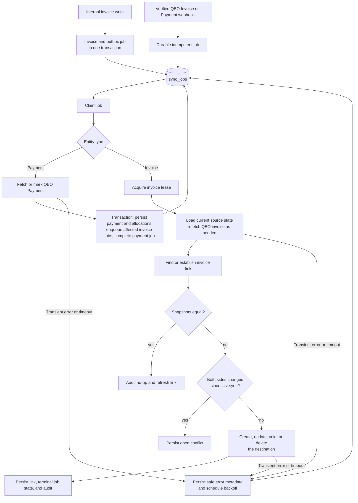
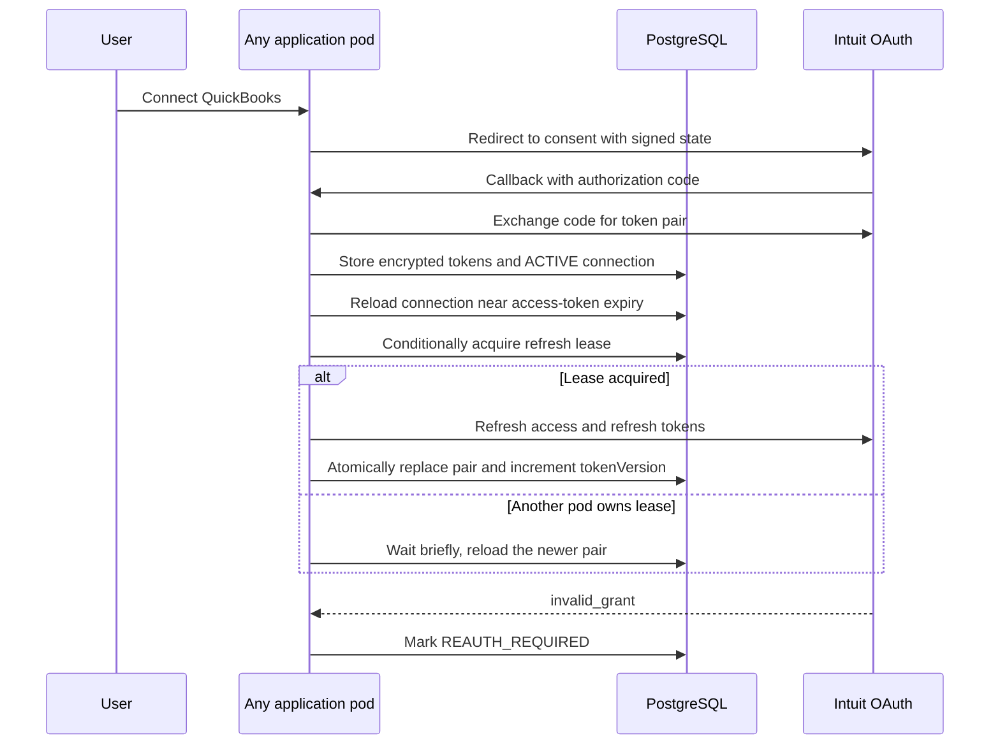

# Design

This document explains the synchronization behavior and its tradeoffs. For local
setup, see [README.md](./README.md); for module ownership and security
boundaries, see [ARCHITECTURE.md](./ARCHITECTURE.md).

## Scope and mapping

The implemented scope is invoices plus QBO-to-internal payment data.
`internal_invoices` represents the internal source system. `invoice_links` stores
the stable internal UUID ↔ QBO Invoice `Id` pair, the latest QBO `SyncToken`, and
the most recently synchronized snapshot from each side. The token provides QBO's
concurrency signal; snapshots make an audit decision explainable.

| Domain         | Current mapping                                     | Extension rule                                            |
| -------------- | --------------------------------------------------- | --------------------------------------------------------- |
| Invoice        | Internal UUID ↔ QBO Invoice `Id`                    | Store stable IDs, never names.                            |
| Invoice line   | Line item carries QBO Item `Id`                     | QBO item configuration supplies its income account.       |
| Payment        | QBO Payment `Id` → internal payment and allocations | Persist payment data, then reconcile each linked invoice. |
| Ledger account | Out of scope                                        | Map internal account ID ↔ QBO Account `Id`.               |

### Deliberate scope boundary

| Decision       | Included                                                             | Left out and why                                                                                                                                                  |
| -------------- | -------------------------------------------------------------------- | ----------------------------------------------------------------------------------------------------------------------------------------------------------------- |
| Payment data   | QBO-to-internal payments and allocations                             | Internal-to-QBO payment creation needs an internal source of truth, payment-entry API, allocation-edit policy, and a deposit-account decision.                    |
| Accounts       | Invoice lines reference existing QBO Items                           | Chart-of-accounts synchronization is a separate master-data lifecycle with its own mapping and approval rules.                                                    |
| General ledger | QBO creates the accounting postings for synced invoices and payments | Creating matching QBO Journal Entries would double-post AR, income, or cash. Only independent manual adjustments should become Journal Entries in a future scope. |

This keeps the take-home focused on an auditable invoice flow while retaining the
payment information required to explain balances and partial payments.

## Synchronization flow

An internal change writes the invoice update and a unique outbox job in one
database transaction. A verified QBO notification creates a durable job before
the webhook returns. The worker always fetches the current state; it does not
apply a webhook body as an event patch, because QBO notification bodies can be
sparse or stale.

The webhook adapter accepts Intuit's CloudEvents payload (the current format)
and the legacy `eventNotifications` envelope during migration. It queues Invoice
and Payment events for the active realm. A CloudEvents event ID becomes the
durable dedupe key; the payload stored with the job contains only that event ID,
not the provider body. It returns `200` only after the matching event is
durably queued; a realm lookup or database failure returns an error so Intuit
retries delivery. Unsupported or malformed event types, and events for an
unconnected realm, return `200` without a job because retrying those permanent
non-actionable deliveries cannot make them processable; the safe
`qbo_webhook_ignored` log records the reason.

Payment events are also queued. The worker refetches the full QBO Payment and
persists its customer, amount, unapplied amount, date, method/reference, and
per-invoice allocations in one transaction with the derived invoice jobs and
source-job completion. The Payment `Id` is stable and unique; its `SyncToken`
defines the idempotent invoice-job key. A deleted payment is retained as a
`DELETED` tombstone, and its previously allocated invoices are reconciled.

`internal_payments` is intentionally QBO-originated in this scope. QBO Invoice
`Balance` remains the source for invoice `OPEN` versus `PAID`; a non-zero balance
also represents a partial payment without adding a redundant status.

## Events, ordering, and idempotency

- `dedupeKey` has a unique constraint, so duplicate deliveries create one job.
- Jobs are claimed with a database lease; each invoice also has a short
  per-entity lease. This serializes competing events for one invoice while
  unrelated invoices continue in parallel.
- Processing is state-based. A delayed or out-of-order event fetches the newest
  source state; an already-matching snapshot is audited as a no-op without a
  destination write.
- QBO updates and voids include `SyncToken`. A stale token causes a refetch and
  retry rather than a silent overwrite.
- When creating a QBO invoice, the worker checks `DocNumber` first. This makes a
  retry after an ambiguous timeout safe. A production integration should also use
  an immutable integration reference/custom field because users can edit numbers.

The link is created safely when an existing invoice is discovered by `DocNumber`,
so systems that predate the integration can be reconciled without immediately
creating duplicates. A production initial-reconciliation workflow would paginate
and review ambiguous matches.

## Conflict and lifecycle policy

The worker uses the last successful internal snapshot and QBO's `SyncToken` for
conflict detection. An internal change conflicts only when QBO's `SyncToken`
also changed; a QBO event conflicts only when the internal snapshot also
changed. The worker refetches QBO after each successful create, update, or void
and stores that canonical snapshot with its `SyncToken`.

This avoids false conflicts from provider-managed fields (such as a generated
due date) or equivalent representations (`100` versus `100.00`). Snapshots are
still retained to explain the decision and to support idempotent state-based
processing. A genuine concurrent edit persists an open conflict and writes
neither system. If only one changed, that side is propagated.

This intentionally does not use automatic last-writer-wins for invoice amounts
or payment status. For example, a QBO payment change and an internal amount edit
remain a conflict for explicit resolution rather than risking an accounting
inconsistency.

| Internal lifecycle | QBO behavior                                 | Concurrent edit behavior           |
| ------------------ | -------------------------------------------- | ---------------------------------- |
| `OPEN`             | Normal create or update                      | The single changed side wins.      |
| `PAID`             | Payment state is part of conflict detection  | Payment vs amount edit is flagged. |
| `VOID`             | QBO transaction remains but is voided/zeroed | Void vs edit is flagged.           |
| `DELETED`          | QBO transaction is deleted                   | Delete vs edit is flagged.         |

A QBO deletion notification is treated as an authoritative tombstone only when
the internal invoice is unchanged; otherwise it becomes a delete-vs-edit
conflict. Internal `VOID` and `DELETED` remain separate soft terminal states so
the original accounting meaning is retained.

## Failure and recovery

External failures and timeouts preserve a safe error code, category, upstream
status, request ID, and route pathname—never a raw provider response, credentials,
or customer data. Jobs retry transient errors with exponential backoff capped at
one hour. After ten attempts, a job becomes `FAILED` with an audit record; it is
not lost if the process crashes mid-attempt.

When QBO is not connected, is reconnecting, or is unavailable to this service, a
job enters a durable dependency-wait state instead. It is rescheduled after the
configured delay without incrementing its retry count, then resumes automatically
after the connection is restored.

The successful path atomically updates the link, job state, and audit record.
The creation lookup described above protects the remaining unavoidable ambiguity:
the provider may accept a request just before the client times out.

## QBO connection lifecycle

OAuth tokens are encrypted in `qbo_connections`; the database is shared source
of truth while individual pods may cache a still-valid access token. A conditional
refresh lease and `tokenVersion` mean one pod rotates a token pair. A QBO 401
first reloads shared state and retries once, because another pod may have already
refreshed it. An `invalid_grant` marks the connection `REAUTH_REQUIRED`; the
protected connection route starts normal consent again and resumes sync after the
callback succeeds.

## HPA-ready Kubernetes deployment

The service is a stateless Kubernetes Deployment whose replica count can be
managed by a Horizontal Pod Autoscaler (HPA). HPA chooses how many pods run;
PostgreSQL preserves correctness while that count grows or shrinks. Kubernetes
chooses the highest desired replica count when an HPA has multiple metrics, so a
production deployment should use a backlog signal as its primary sync metric and
CPU or memory as supporting safeguards. [Kubernetes HPA documentation](https://kubernetes.io/docs/concepts/workloads/autoscaling/horizontal-pod-autoscale/)

Recommended production configuration:

- Keep at least two replicas for webhook availability. Do not scale this public
  webhook service to zero: Intuit needs a ready listener and would retry during
  cold start.
- Scale up from a custom/external metric such as ready-job count or oldest
  ready-job age. CPU alone measures process activity, not sync latency. Exporting
  that metric and configuring a metrics adapter are intentionally outside this
  take-home implementation.
- Use scale-down stabilization and a graceful termination period. A terminating
  pod stops polling; durable jobs not completed by it remain recoverable by
  another pod.
- Set `APP_DB_POOL_MAX` and QBO HTTP-pool limits with `maxReplicas` in mind, so
  total PostgreSQL connections and outbound QBO concurrency stay within their
  respective budgets.

PostgreSQL, rather than process memory, is the coordination point:

- The durable job table and unique dedupe keys make webhook acceptance and
  retries safe when requests land on different pods.
- `skip_locked` job claims and the short per-invoice lease ensure that one pod
  processes a job or invoice at a time, while unrelated invoices process in
  parallel.
- The invoice write and its outbox job are one transaction. A pod crash cannot
  leave a committed internal change without durable sync work to recover it.
- Encrypted QBO tokens, the refresh lease, and `tokenVersion` are shared in the
  database. Each pod may cache only a still-valid access token; it never owns
  the connection state.
- Migrations run once before rollout, and health probes stay in memory. A
  transient database or QBO outage therefore creates retryable work rather than
  causing every pod to restart.

These decisions intentionally favor a shared database-backed queue over a
broker for the take-home scope. They preserve correctness under HPA-driven
horizontal scaling while keeping the operational surface area small.

## Deliberate tradeoffs

- Migrations run in a deployment pipeline or dedicated Job, not on application
  startup. This prevents concurrent-pod migration races.
- Kubernetes liveness and readiness are in-memory checks. They do not probe
  PostgreSQL or QBO on every call, so a dependency outage does not cause a
  restart storm or stop webhook recovery.
- The scope boundary above intentionally leaves out internal-to-QBO payment
  creation, account synchronization, and general-ledger entries. It also omits a
  dead-letter UI, metrics/alerts, customer/item mapping, and a paginated initial
  reconciliation.
- Static internal and QBO setup keys are deliberately distinct. Production should
  replace internal static-key authorization with identity-aware authorization and
  bind OAuth state to a server-side user session.
